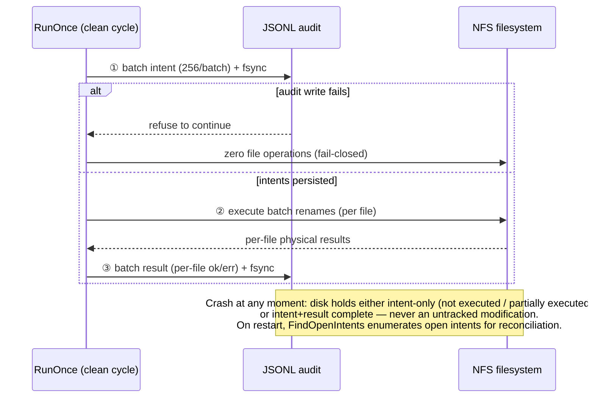

# filecleaner

**Production-safe scheduled cleaner for NFS-mounted directory trees — soft-delete first, audit everything.**

English | [简体中文](README.zh-CN.md)

[](https://go.dev)
[](https://kernel.org)
[](./go.mod)

`filecleaner` runs as a daemon on a Linux host with NFS mounts, scans directory trees on schedule, and moves expired files into a date-bucketed trash area via `rename(2)` — cheap on NFS, reversible for a retention window, and fully audited in an intent-before-action transaction log.

It is built for the harsh end of the spectrum: **multi-million-file trees, deep-narrow layouts, shared storage where other machines write concurrently, and hard-mounted NFS where a stalled RPC puts your process in D-state.**

---

## Why not `find /data -mtime +30 -delete`?

| | `find -delete` | rsync/tmpwatch style | filecleaner |
|---|---|---|---|
| Recovery window after a bad match | ❌ none — unlink is final | ❌ partial | ✅ trash retention (default 10d), `restore` command |
| Proof of what was deleted, when | ❌ exit code | ⚠ verbose logs, best-effort | ✅ pre-commit JSONL audit + SQLite projection, per-file `ok` |
| Crash mid-run | ❌ unknown state | ⚠ unknown state | ✅ intent fsynced before action; open intents enumerated on restart |
| Wrong-mount / empty-mount protection | ❌ deletes anyway | ❌ | ✅ `st_dev` guard, `RequiresMountsFor` unit, fail-closed excludes |
| Deleting on live NFS | ⚠ metadata storms | ⚠ | ✅ concurrent rename batches, per-tree tuned worker pools |
| Empty dir cleanup | ❌ | ⚠ racy | ✅ TOCTOU recheck + mtime age gate + `ENOTEMPTY` kernel backstop |

The short version: `find` optimizes for *space reclaim now*. filecleaner optimizes for *being able to answer "what happened to that file" three weeks later* — while still reclaiming space.

## Features

- **Soft delete with date-bucketed trash** — files move into `<root>/.filecleaner-trash/2026-10-22.run-<id>/` preserving relative paths. Retire at expiry is an O(1) directory rename (~34 ms), physical unlink happens asynchronously in the background.
- **Restore before expiry** — `filecleaner restore` walks the audit projection, finds the bucket holding your file, moves it back. Refuses to overwrite existing files.
- **Audit-first transaction log** — every batch persists `intent` records (fsync) *before* touching the filesystem, then per-file `result` records. Any crash leaves either intent-only or intent+result — never an untracked modification. JSONL shards rotate daily by default, retention configurable.
- **Per-policy matching** — cron schedule, `mtime`/`ctime`/`atime` conditions combined with AND/OR, quiet-period check, basename dir excludes, glob/regex file excludes.
- **Empty-directory sweep** — removes directories that are empty and mtime-older than a gate (POSIX mtime updates on entry add/remove, so freshly-emptied dirs are naturally protected). Three-layer safety: readdir recheck → age gate → kernel `ENOTEMPTY` backstop.
- **NFS-tuned concurrency** — separate worker pools for directory reads, `lstat` storms, and rename batches. Throughput bottleneck on deep-narrow trees is directory traversal, not stat parallelism (bench-proven; see below).
- **Crash-safe three-zone lifecycle** — active buckets / `.retired/` / `.purging/` separated by atomic renames; restart resumes physical deletion idempotently.
- **Single static binary** — pure Go, `CGO_ENABLED=0`, no runtime deps beyond the SQLite projection (modernc, no cgo).

## Quick start

```bash
git clone https://github.com/cnyup/file-cleaner.git
cd file-cleaner
CGO_ENABLED=0 go build -o filecleaner ./cmd/filecleaner

cp config.example.yaml config.yaml    # edit policies for your tree
./filecleaner validate --config config.yaml
./filecleaner once --config config.yaml --policy video-data-daily --dry-run
./filecleaner once --config config.yaml --policy video-data-daily
```

A minimal policy:

```yaml
state_dir: /var/lib/filecleaner

policies:
  - id: my-tree
    root: /mnt/nfs/data
    schedule: "30 2 * * *"
    retention:
      match: AND
      conditions:
        mtime_older_than: 30d
        atime_older_than: 30d
    trash:
      retention: 10d
      purge_schedule: "15 4 * * *"
    empty_dirs:
      enabled: true
      retention: 7d
```

Full reference for every key and default: [`config.example.yaml`](config.example.yaml).

## How it works

```mermaid
flowchart LR
    A[Source tree<br/>policy match] -->|rename, batched| B[Active bucket<br/>restore window]
    B -->|expiry retire<br/>O(1) rename ~34ms| C[.retired]
    C -->|sweep claims| D[.purging]
    D -->|background unlink| E[space reclaimed]
    B -->|restore| A
```

- **Deletion is two-phase by design.** Logical deletion (retire) is instantaneous and holds the policy lock for milliseconds; physical deletion runs in an hourly sweeper loop that never touches buckets that did not pass through `.retired/` (fail-closed).
- **The audit log is the source of truth.** The SQLite store is a rebuildable projection (`audit rebuild` reconstructs it from JSONL). Restore queries the projection; pruning respects the invariant that audit shards always outlive trash retention.
- **Daemon = three independent schedules.** Per-policy `schedule` (clean), `purge_schedule` (retire), and an hourly sweeper (physical delete). Same-policy operations serialize via flock; an unfinished run causes the next trigger to skip.

## Audit transaction protocol (the crash-safety core)



## CLI reference

| Command | Purpose |
|---|---|
| `validate` | Fail-closed config check (schema, cron, cross-field invariants) |
| `once` | Run one policy now (`--dry-run` reports matches without moving) |
| `daemon` | All schedules + sweeper + audit rotation/prune loop |
| `restore` | Move a file back from trash by relative path |
| `purge` | Retire expired buckets (manual trigger; daemon does this on schedule) |
| `sweep` | Manually run physical deletion of `.retired`/`.purging` |
| `audit query` / `audit rebuild` | Query projection; rebuild it; `--check-open` lists crash-orphaned intents |
| `bench scan` | Measure scan throughput for a tree to tune worker counts |

## Safety invariants

1. Intent records are fsynced **before** any file operation; if the audit log is unwritable, zero files are touched.
2. Trash must share `st_dev` with root — cross-device fallback is rejected, never copy.
3. Excludes win over matches; symlinks are never followed; the trash tree itself is never scanned.
4. Sweeper deletes only buckets that passed through `.retired/`; active buckets and unknown files are never touched.
5. Per-policy flock: an unfinished run blocks re-entry rather than overlapping.
6. Timers separate scan / drain / total elapsed — total wall time never masquerades as scan time.
7. Empty-dir removal triple-checks: readdir immediately before `rmdir`, mtime age gate, kernel `ENOTEMPTY`.

## Benchmarks

Measured on cloud capacity-tier NFS, 6M files / 1M dirs, production-shaped deep-narrow tree:

| Operation | filecleaner | predecessor tool |
|---|---|---|
| Full scan | **23,067 files/s** | 7,895 files/s (2.9×) |
| Retire 1 bucket (logical delete) | **34 ms**, independent of file count | ~46 s per equivalent batch |
| Physical delete (background) | ~110 files/s (NAS metadata wall; async, non-blocking) | same wall |
| Soft-delete ingest | ~120 files/s (same wall; tune `move_workers` + off-peak window) | — |

Tuning note from these benches: raising `dir_read_workers` scales throughput nearly linearly (4.3k → 17.1k files/s at 8 → 64 workers); raising `stat_workers` beyond ~32 gains almost nothing on deep-narrow trees.

## Documentation

- [`config.example.yaml`](config.example.yaml) — every key, default, and constraint annotated
- [`docs/operations.md`](docs/operations.md) — runbook: restore drills, audit forensics, daemon supervision
- [`docs/performance.md`](docs/performance.md) — benchmark methodology and NFS-specific findings
- [`docs/superpowers/specs/`](docs/superpowers/specs/) — design docs (trash bucketing, core architecture)

## License

Not yet chosen — add a `LICENSE` file before relying on this in production.
