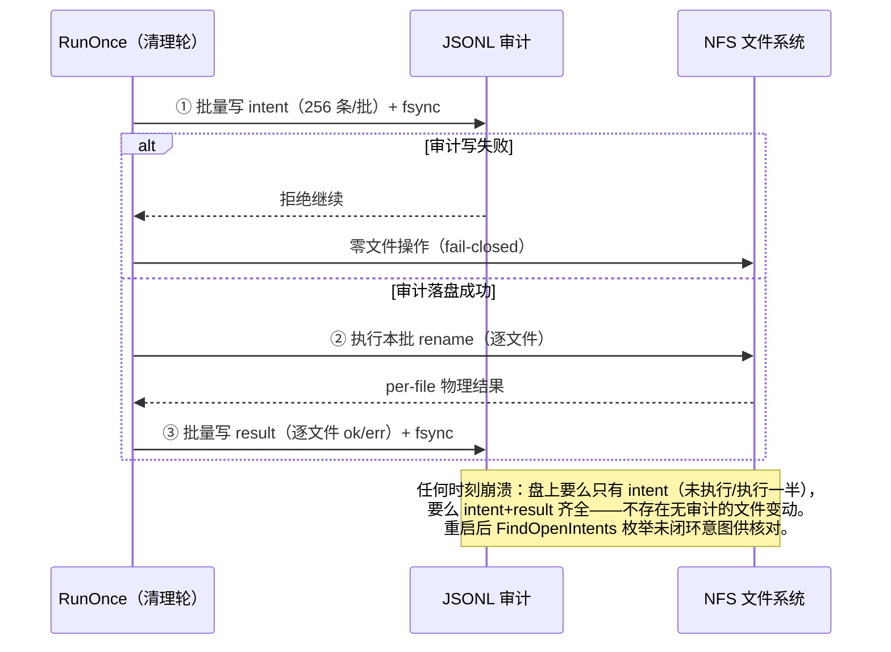
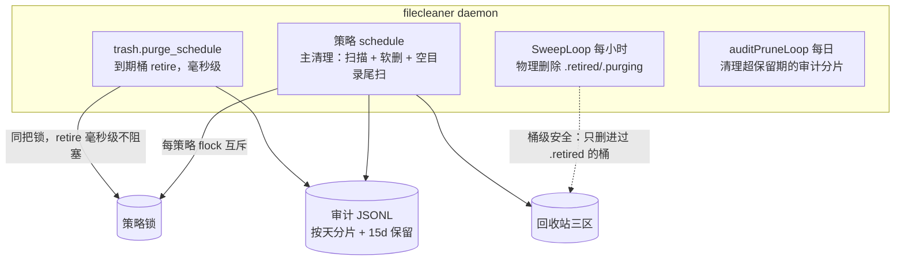

# filecleaner（中文文档）

[English](README.md) | 简体中文

**面向 NFS 挂载目录树的生产级定时清理工具——软删除优先，全程审计。**

`filecleaner` 以 daemon 形式运行在挂载了 NFS 的 Linux 主机上，按调度扫描目录树，把过期文件通过 `rename(2)` 移入日期分桶的回收站——在 NFS 上代价极低、在保留期内可恢复，且每一步操作都记录在「先写意图、后动文件」的事务审计日志里。

它专为最恶劣的一端而设计：**数百万文件的目录树、深窄型布局、多台机器并发读写的共享存储、RPC 卡顿会把进程挂进 D 状态的 hard-mount NFS**。

---

## 为什么不用 `find /data -mtime +30 -delete`？

| | `find -delete` | rsync/tmpwatch 类 | filecleaner |
|---|---|---|---|
| 误删后的恢复窗口 | ❌ 没有——unlink 即终点 | ❌ 部分 | ✅ 回收站保留期（默认 10d）+ `restore` 命令 |
| 「那个文件去哪了」的取证 | ❌ 只有一个退出码 | ⚠ 冗长日志、尽力而为 | ✅ 预提交 JSONL 审计 + SQLite 投影，精确到每个文件的 `ok` |
| 运行中崩溃 | ❌ 状态未知 | ⚠ 状态未知 | ✅ intent 先 fsync 再动文件；重启后可枚举未闭环意图 |
| 挂载点错误/未挂载保护 | ❌ 照删不误 | ❌ | ✅ `st_dev` 校验 + systemd `RequiresMountsFor` + fail-closed 排除 |
| 活跃 NFS 上的删除 | ⚠ 元数据风暴 | ⚠ | ✅ 并发 rename 批处理 + 按树调优的 worker 池 |
| 空目录清理 | ❌ | ⚠ 有竞态 | ✅ TOCTOU 复查 + mtime 年龄门 + `ENOTEMPTY` 内核兜底 |

一句话总结：`find` 优化的是「立刻回收空间」，filecleaner 优化的是「三周后还能回答那个文件发生了什么」——同时空间照样回收。

## 核心特性

- **日期分桶软删除**——文件按原相对路径移入 `<root>/.filecleaner-trash/2026-10-22.run-<id>/`。到期 retire 是一次 O(1) 目录 rename（约 34ms），物理 unlink 在后台异步执行。
- **到期前可恢复**——`filecleaner restore` 走审计投影定位文件所在桶，移回原位；拒绝覆盖已存在的文件。
- **审计先行的事务日志**——每批操作先把 `intent` 记录落盘（fsync）再动文件系统，然后逐文件写 `result`。任何时刻崩溃，盘上要么只有 intent、要么 intent+result 齐全——不存在「文件动了但审计没记」的窗口。JSONL 分片默认按天轮转，保留期可配置。
- **策略级匹配**——cron 调度、`mtime`/`ctime`/`atime` 条件 AND/OR 组合、静默期检查、basename 目录排除、glob/正则文件排除。
- **空目录清理**——只删「空且 mtime 超龄」的目录（POSIX 目录 mtime 在条目增删时都更新，刚清空的目录天然被挡住）。三重保险：删前 readdir 复查 → mtime 年龄门 → 内核 `ENOTEMPTY` 兜底。
- **NFS 调优并发**——目录读取、`lstat` 风暴、rename 批处理分别独立 worker 池。深窄树的吞吐瓶颈在目录遍历而非 stat 并行（bench 实证，见下文）。
- **崩溃安全的三区生命周期**——活跃桶 / `.retired/` / `.purging/` 由原子 rename 分隔，重启后幂等续删。
- **单静态二进制**——纯 Go、`CGO_ENABLED=0`，除 SQLite 投影（modernc 纯 Go 实现）外零运行时依赖。

## 文件生命周期（软删除流程）

```mermaid
flowchart LR
    A[源目录树<br/>策略命中] -->|rename 逐文件<br/>~120/s<br/>批内并发| B[活跃桶<br/>restore 窗口内可恢复]
    B -->|到期 retire<br/>O(1) rename ~34ms| C[.retired<br/>已隔离待删]
    C -->|sweeper 领取| D[.purging<br/>删除中标记]
    D -->|后台逐文件 unlink<br/>~110/s 异步| E[空间释放]
    B -->|restore 反向 rename| A

    style A fill:#e1f5fe
    style B fill:#e8f5e9
    style E fill:#fce4ec
```

## 审计事务协议（崩溃安全的核心）



## daemon 架构（三条独立调度线 + 受限并行）

同一时刻到期的多策略按 `max_concurrent_runs`（缺省 2，=1 即完全串行）并行执行；同策略仍由 flock 严格串行（上一轮未完成，本轮跳过）。

## run_finished 指标怎么读

每轮结束落一条 `run_finished` 审计事件，各计数口径：

| 键 | 含义 |
|---|---|
| `moved` / `move_errors` | 物理移动结果（批事务真相，非入队计数）。`move_errors` 只计**真**失败（EACCES 等）——非零即需人工关注。 |
| `already_gone` | 扫描后、移动前被业务侧删走的文件（ENOENT）。良性竞态非失败；不进 `move_errors`，但 per-file 审计 result 仍记 `ok:false`（restore 投影 fail-closed）。 |
| `scan_ms` / `drain_ms` / `total_ms` / `empty_dirs_ms` | 分阶段耗时：扫描+判定 / 移动排空 / 全程 / 空目录尾扫（第二次全树走）——用于长轮次归因。 |



## 快速开始

```bash
git clone https://github.com/cnyup/file-cleaner.git
cd file-cleaner
CGO_ENABLED=0 go build -o filecleaner ./cmd/filecleaner

cp config.example.yaml config.yaml    # 按你的目录树编辑策略
./filecleaner validate --config config.yaml
./filecleaner once --config config.yaml --policy video-data-daily --dry-run
./filecleaner once --config config.yaml --policy video-data-daily
```

最小策略示例：

```yaml
state_dir: /var/lib/filecleaner

policies:
  - id: my-tree
    root: /mnt/nfs/data
    schedule: "30 2 * * *"
    retention:
      match: AND
      conditions:
        mtime_older_than: 30d
        atime_older_than: 30d
    trash:
      retention: 10d
      purge_schedule: "15 4 * * *"
    empty_dirs:
      enabled: true
      retention: 7d
```

每个配置项、默认值与约束的完整说明见 [`config.example.yaml`](config.example.yaml)。

## 命令参考

| 命令 | 用途 |
|---|---|
| `validate` | fail-closed 配置校验（schema、cron、跨字段不变量） |
| `once` | 立即执行一个策略（`--dry-run` 只报命中不移动） |
| `daemon` | 全部调度线 + sweeper + 审计轮转清理 |
| `restore` | 按相对路径把文件从回收站移回原位 |
| `purge` | retire 到期桶（手动触发；daemon 按调度自动做） |
| `sweep` | 手动物理删除 `.retired`/`.purging` |
| `audit query` / `audit rebuild` | 查询投影；重建投影；`--check-open` 列出崩溃残留的未闭环意图 |
| `bench scan` | 实测目录树扫描吞吐，用于调 worker 数 |

## 安全不变量

1. 每批文件操作**之前** intent 已 fsync 落盘；审计不可写 → 该批零文件操作
2. 回收站与 root 必须同 `st_dev`——跨设备直接拒绝，绝不 copy
3. 排除规则优先于命中；符号链接永不跟随；回收站自身永不进入扫描
4. sweeper 只删进过 `.retired/` 的桶；活跃桶与未知文件永不删（fail-closed）
5. 策略级 flock：上一轮未完成 → 本轮跳过，绝不重叠执行
6. scan / drain / total 分开计时——总时长永不冒充扫描时长
7. 空目录删除三重复查：rmdir 前 readdir、mtime 年龄门、内核 `ENOTEMPTY`

## 性能实测

云端容量型 NAS、600 万文件 / 百万目录、生产形态深窄树：

| 操作 | filecleaner | 前代工具 |
|---|---|---|
| 全量扫描 | **23,067 files/s** | 7,895 files/s（2.9 倍） |
| retire 单桶（逻辑删除） | **34ms**，与桶内文件数无关 | 同规模逐文件 purge 约 46s |
| 物理删除（后台） | ~110 files/s（NAS 元数据写墙；异步不阻塞前台） | 同一面墙 |
| 软删除入桶 | ~120 files/s（同一面墙；调 `move_workers` + 业务低峰窗口） | — |

调优结论（来自上述 bench）：`dir_read_workers` 近线性扩展吞吐（8→64 worker：4.3k→17.1k files/s）；深窄树上 `stat_workers` 超过 ~32 几乎无收益。

## 文档

- [`config.example.yaml`](config.example.yaml)——全部配置项、默认值、约束，逐项注释
- [`docs/operations.md`](docs/operations.md)——运维手册：恢复演练、审计取证、daemon 监管
- [`docs/performance.md`](docs/performance.md)——benchmark 方法论与 NFS 专项结论
- [`docs/superpowers/specs/`](docs/superpowers/specs/)——设计文档（trash 分桶、核心架构）

## 许可证

尚未选定——生产依赖前请先补 `LICENSE` 文件。
