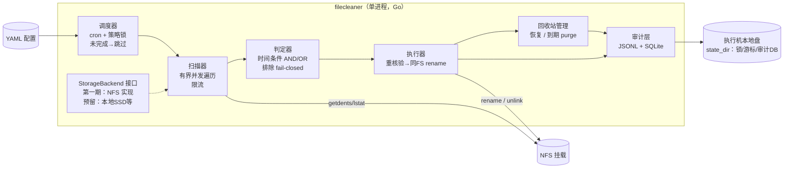

# filecleaner 设计文档

> 状态：待用户审阅 · 2026-06-14 · 所有决策均经用户逐项确认

## 1. 背景与目标

一个面向 TB 级数据、海量小文件、深目录层级的 NFS 定时清理工具。核心诉求：执行快、按目录配置策略、可排除、软删除可恢复、可审计可溯源。

## 2. 需求 → 设计映射

| 用户原始需求 | 设计回应 | 章节 |
|---|---|---|
| TB 级数据 / 大量小文件 / 深层级 | 有界并发流水线扫描 + 三层限流 + 增量剪枝（可选） | §8 |
| 执行速度快 | 并发 readdir/stat、令牌桶保护 NFS、基准工具实测验证 | §8 |
| 按目录配置定时策略 + 排除过滤 | YAML 每目录一策略：cron / 时间条件 / 排除规则 | §4 |
| 软删除 | 同 NFS 文件系统 rename 进回收站，可恢复，到期物理删除 | §6 |
| 不同存储类型不同清理方式 | StorageBackend 接口，第一期仅 NFS 实现（本地盘仅存状态） | §3 |
| 删除可审计可溯源 | JSONL 追加 + SQLite 查询导出，逐文件生命周期记录 | §7 |

## 3. 已确认决策记录

| 维度 | 决策 | 备注 |
|---|---|---|
| 平台 | Linux（执行机） | 开发机 Mac 仅编辑代码，构建测试在远程（项目 AGENTS.md 约定） |
| 存储 | 第一期仅 NFS；同一 NFS 被业务机读写，但清理仅单机运行 | 多机清理不在第一期范围 |
| 形态 | 单二进制守护进程 + CLI；无 Web | Go 实现 |
| 软删除 | **全部软删除**：rename 进 `<root>/.filecleaner-trash/`，保留期内空间不释放（用户已接受） | 不提供直接物理删除模式 |
| 判定条件 | mtime/ctime/atime 组合，默认 AND，策略可显式 OR | ctime≠创建时间、atime 受挂载参数影响——配置文档明示 |
| 调度 | 进程内 cron 表达式；每策略并发上限可配；上次未完成→跳过（本地 flock 实现，不依赖裸 crontab） | |
| 业务信号 | 无封存标记，仅时间属性 + 静默期推断 | 残余风险见 §10 |
| 审计 | 本地 JSONL + SQLite，无集中平台 | 审计存执行机本地盘，不存 NFS |
| 回收站生命周期 | 到期自动物理删除，保留期按策略配置 | |
| 实现策略 | 新仓库从零重写；旧工程仅作算法与失败模式参考 | 不复制目录容量汇总、Top-N、硬链接去重及历史架构包袱 |
| 增量索引 | 第一期不做，每次按策略全量扫描 | 全量扫描是事实来源；索引列为后续可选能力 |
| 性能目标 | 相同 NFS、相同数据快照、相近业务负载下，全量扫描耗时较旧工具减少约 50% | 目标而非承诺；以真实 NFS 对照测试验收 |

## 4. 总体架构



不变量：

- **数据操作只发生在 NFS**；锁、游标、审计全部在执行机本地盘 `state_dir`（NFS 锁语义不可靠，不使用 NFS 锁）。
- 软删除路径 = 同文件系统 `rename`，原子、不复制数据块；失败（EXDEV/ENOENT/EACCES）记审计跳过，**绝不回退为"复制后删除"**。
- `state_dir` 磁盘满 → 清理暂停并告警（审计写不进去就不能继续删）。

## 5. 配置模型（YAML）

```yaml
state_dir: /var/lib/filecleaner          # 本地盘：锁、游标、审计
policies:
  - id: data-a-daily                     # 策略唯一 ID，进审计记录
    root: /mnt/nfs/data_a
    schedule: "30 2 * * *"               # cron 表达式，进程内调度
    retention:
      match: AND                         # AND | OR，默认 AND
      conditions:
        mtime_older_than: 30d            # mtime/ctime/atime 任意组合
        atime_older_than: 30d
      min_quiet_period: 1h               # 静默期：近 1h 内 mtime/ctime 有变则跳过
    exclusions:
      dirs: ["tmp", ".snapshots"]        # 相对/绝对路径目录排除
      patterns: ["*.log", "re:^keep_"]   # glob 或 re: 前缀正则
    trash:
      dir: .filecleaner-trash            # 默认 root 下隐藏目录；自定义时校验同 st_dev
      retention: 30d                     # 回收站保留期，到期 purge
      purge_schedule: "15 4 * * *"       # purge 独立 cron，默认每日低峰；与主清理互斥（同一把锁）
    concurrency:
      scan_workers: 16
      move_workers: 8
      max_ops_per_sec: 0                 # 全局令牌桶，0=不限速（默认）；服务器扛不住时才设值，作紧急刹车用
    incremental_prune: false             # 目录 mtime 剪枝，仅"只写不改"目录开启
```

启动校验（fail-closed，任一失败该策略禁用并显式报错）：cron 表达式合法；root 存在且可读；trash 目录与 root 同 `st_dev`；时间参数 ≥0 且格式合法；policy id 全局唯一。策略级禁用不影响其他策略运行。

## 6. 回收站设计

**位置与语义**：`<root>/.filecleaner-trash/<原相对路径>`，原目录结构原样保留；同名二次回收加时间戳后缀。回收站在 NFS 上，不占本地盘空间；保留期内源数据空间不释放（已确认接受）。

**事实源**：回收站条目的生命周期状态以本地 SQLite（审计导入）为唯一事实源，不依赖回收站内文件的 ctime（rename 在多数文件系统上不改文件自身 ctime，不可靠）。

**恢复**（`filecleaner restore`）：按路径前缀或 run_id 查询 DB 中 `status=moved` 的条目 → 反向 rename 回原路径 → 记 `restored` 事件。原路径已存在新文件 → 该条目中止并提示，**不覆盖**。

**Purge**（到期物理删除）：**独立 cron 调度**（策略内 `purge_schedule`，默认每天一次低峰期，如 "15 4 * * *"），与主清理分开持锁——两者互斥（同一把策略锁，谁先拿到谁执行），但不在同一次 run 内串联执行，避免 purge 把清理窗口拉长导致下次主清理被"跳过"。算法：查询 DB `status=moved AND moved_at < now - trash.retention` → 逐条 unlink 回收站路径 → 记 `purged` 事件 → 自底向上清理空目录。**fail-closed**：回收站里存在但 DB 查不到的路径不删，输出告警并提供 `filecleaner audit rebuild`（扫回收站重建索引）。

## 7. 审计设计

事件类型：`moved / restored / purged / skipped / error / run_started / run_finished`。移动/恢复/purge 逐文件记录；扫描跳过按原因汇总计数（per-run 聚合行）。

逐文件记录字段：`ts / run_id / policy_id / policy_hash（配置内容哈希，即策略版本标识） / event / src_path / trash_path / size / inode / mtime / ctime / atime / matched_conditions / skip_reason / error`。

写入路径：内存 buffer → 批量 append JSONL + 周期 fsync（崩溃最多丢尾部数秒）→ 定期导入 SQLite（`moved` 状态迁移由此驱动）。溯源查询：`filecleaner audit query --policy X --path P --since ... --status moved`，支持导出 JSONL/CSV。

SQLite 单写多读（WAL），仅查询走 DB，写入热路径只碰 JSONL 文件。

## 8. 并发与性能设计

- **流水线**：目录读取、文件 stat、文件 rename 使用相互独立的有界队列与 worker 池，避免慢 rename 反向耗尽目录遍历并发；背压由各级 channel 容量自然传导。命中者进入 move 队列，move worker 执行重核验 + rename。**重核验失败（扫描到移动之间文件被业务修改/删除）→ 该文件跳过，记 skipped 事件，不重试本轮**；下一轮 cron 重新评估。
- **NFS 遍历内核**：借鉴旧工程已验证的分批流式 `ReadDir`、目录 fd 相对 `fstatat(AT_SYMLINK_NOFOLLOW)`、一级子树并行扇出与取消收敛语义，但在新仓库独立实现并测试；不引入容量统计、Top-N、硬链接容量去重。
- **独立并发控制**：`dir_read_workers`、`stat_workers`、`move_workers` 分别配置；全局 `max_ops_per_sec` 仅作紧急刹车，默认 0（不限速）。TB 级小文件瓶颈通常是元数据 RPC 往返，并发能提升吞吐但可能冲击 NFS server，必须用真实环境并发曲线确定默认值。
- **单遍扫描**：第一期不做源目录空目录清理，避免文件处理结束后再遍历整棵目录树；回收站 purge 仅遍历回收站自身。控制台不逐文件打印 Info 日志，进度按固定时间间隔聚合输出。
- **READDIRPLUS 属性缓存**：利用内核 NFS 目录读附带属性减少逐文件 RPC——收益需基准实测确认，文档标注"未实测不承诺"。
- **增量剪枝**（默认关）：目录 mtime 早于阈值且策略声明"只写不改"时整树跳过。业务会原地改文件的场景禁用。
- **基准工具**（随项目交付，`filecleaner bench`）：生成指定规模小文件树，实测不同并发参数下的扫描/移动速率曲线。**"执行速度快"以该工具在真实 NFS 上的实测数字为证，本文档不做性能承诺。**

## 9. 安全机制

- 移动前逐文件重核验：时间条件 + 静默期 + 非 symlink + 未跨挂载点（st_dev 与 root 一致）。
- 排除规则优先于清理条件；规则求值异常 → 该文件跳过（fail-closed），不静默放行。
- `--dry-run`：完整走扫描→判定→重核验流程，只输出计划不执行 rename。
- 优雅停止：SIGTERM → 停止扫描入队 → 完成在途 rename → 刷审计 → 释放锁。run 状态持久化，下次触发按"未完成→跳过"处理直到锁释放。
- 锁：`state_dir/locks/<policy_id>.lock`，`flock(LOCK_EX|LOCK_NB)`，拿不到即跳过并记审计。

## 10. 明示风险与限制（不假装已解决）

1. **无业务封存信号**：静默期 + 移动前重核验只能降低、不能消除"移动了正在使用的文件"的残余风险（重核验与 rename 之间存在窗口）。
2. **内核属性缓存**：NFS 客户端 `acregmax` 默认 60s，重核验的 stat 可能读到缓存旧值；部署文档给出挂载参数调优建议（如 `acregmin/acregmax` 调小），代价是 RPC 增多。
3. **atime 语义**依赖挂载与服务端配置（noatime/relatime），仅作辅助条件时风险可控；作为必要条件时文档警告。
4. **审计尾部丢失窗口**：崩溃时最多丢数秒 JSONL（未及 fsync 的 buffer）；对应文件已移动但 DB 无记录 → purge 阶段 fail-closed 不删，需 `audit rebuild`。
5. **单机清理假设**：锁在本地盘，防本机重叠；他机同时跑清理工具会产生竞争——部署约束必须写明。
6. **回收站空间占用**：保留期内不释放，容量规划须按"日清理量 × 保留期"预估峰值。

## 11. 第一期非目标

- 多执行节点 / 集中管理面 / Web UI
- 本地 SSD 等其他存储后端（接口预留）
- 对象存储、SMB、CephFS
- 直接物理删除模式（用户确认全部软删除）
- 源目录空目录清理（避免删除后第二次全树扫描；后续可拆成独立低频工具）
- 目录容量汇总、Top-N、硬链接容量去重（用户计划拆成独立工具）
- 增量文件索引（第一期坚持全量扫描）
- ACL/权限管理、多租户

## 12. 验证计划

- 单元测试：判定器条件矩阵（AND/OR×三时间属性×边界值）、排除规则、配置校验、purge 状态机（Go test）。
- 集成测试：本地目录树模拟（tmpdir），覆盖移动/恢复/到期 purge/崩溃恢复（锁残留）/同名冲突/审计对账（JSONL 行数 == DB 条目数）。
- NFS 对照验收：在相同 NFS、相同数据快照、相近业务负载下分别运行旧工具与新工具；性能目标为新工具全量扫描耗时减少约 50%。已知旧基线与目标：5,484,345 文件 `1h53m23s → ≤56m42s`；7,821,071 文件 `1h52m41s → ≤56m21s`；`/app/video-data` 6,580,814 文件 `2h11m25s → ≤1h05m43s`。上述目标待真实环境验证，未测前不声称达标。
- 并发拐点测试：`filecleaner bench` 分别测纯 readdir、readdir+fstatat，以及 stat 并发 1/4/8/16/32/64；记录 files/s、P50/P95/P99 stat 延迟、错误率和对业务侧延迟的影响。扫描阶段与 rename drain 阶段分别计时，禁止把两者混成单一性能数字。
- 开发流程按项目 AGENTS.md：本地编辑，远程构建测试。

## 13. 演进路径（按需启用，不预建）

多节点执行（锁升级为 NFS/分布式租约）→ 增量索引（候选索引 + 最终重核验 + 周期性全量对账）→ 集中策略下发与审计汇聚（gRPC/HTTP）→ Web 管理 → 本地 SSD 后端（利用 inotify/批量 syscall 差异化提速）。

## 14. CLI 参考

```
filecleaner run --config <yaml>            # 守护进程：cron 调度各策略
filecleaner once --policy <id> [--dry-run] # 手动单次执行（同锁语义）
filecleaner restore --policy <id> --path <p>|--run <id>
filecleaner purge --policy <id>            # 手动触发回收站清理
filecleaner audit query [--policy] [--path] [--since] [--status] [--format json|csv]
filecleaner audit rebuild                  # 从回收站重建 DB 索引
filecleaner bench --files N --size S --depth D   # 基准工具
filecleaner validate --config <yaml>       # 配置校验（CI 可用）
```
